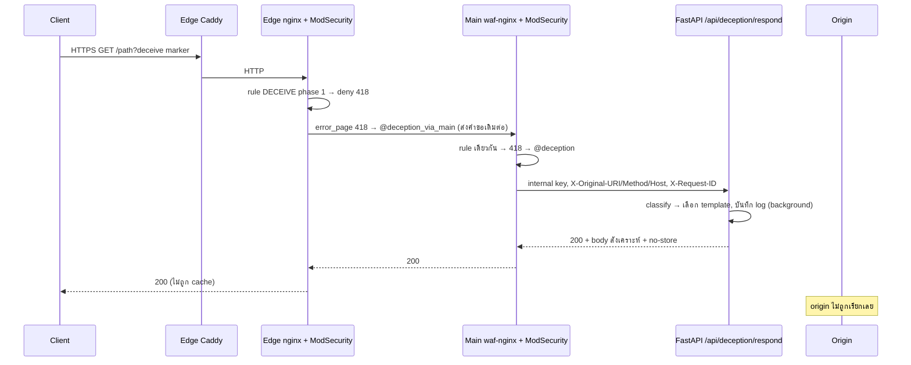

# บทที่ 17 — Deception Layer (ชั้นหลอกล่อผู้โจมตี)

> ข้อมูลทั้งหมดที่ deception layer ส่งกลับเป็น **ข้อมูลสังเคราะห์ (synthetic)** ที่สร้างในหน่วยความจำ (`services/deception_content.py`) ไม่ได้อ่านจากไฟล์หรือฐานข้อมูลจริงของเครื่องใดๆ และ origin ไม่ถูกติดต่อ

## 17.1 ภาพรวม

แทนที่จะตอบ 403 กับคำขอบางประเภท ระบบตอบ 200 พร้อมเนื้อหาปลอมที่ดูเหมือนการโจมตีสำเร็จ เพื่อสิ้นเปลืองเวลาของผู้โจมตีและเก็บข้อมูลพฤติกรรม โดยใช้ status พิเศษ **418** เป็นสัญญาณภายในระหว่าง ModSecurity กับ nginx

*รูปที่ 12 — ลำดับการทำงานของคำขอที่ถูกส่งเข้า deception*

## 17.2 การเลือกคำขอที่จะหลอก

- ผู้ดูแลสร้างกฎ action **DECEIVE** จากหน้า WAF Rules (`services/rule_manager.py`) ได้ directive `phase:1,deny,status:418,tag:'action:deceive'`
- ทำงานใน **phase 1** เพื่อให้ตัดสินก่อน CRS 949110 (anomaly block ใน phase 2) ข้อจำกัด: phase 1 ยังไม่มี body จึงห้ามใช้ `REQUEST_BODY` กับ DECEIVE (ระบบปฏิเสธ)
- กฎทดสอบที่มีอยู่: `modsecurity/custom-rules/custom-deceive.conf` (id 9000000 และ 9000001 จับ marker ใน `REQUEST_URI`)
- คำขอโจมตีทั่วไปที่ไม่ตรงกฎ DECEIVE ยังถูก CRS บล็อกด้วย 403 ตามปกติ (ทดสอบจริง)

## 17.3 การส่งต่อ

| ชั้น | กลไก | ไฟล์ |
|---|---|---|
| Edge | `error_page 418 = @deception_via_main` → proxy คำขอเดิมไป Main (ไม่มี cache, timeout 2s/20s) | edge `default.conf.template` |
| Main | `error_page 418 = @deception` → rewrite เป็น `/api/deception/respond` → FastAPI | `nginx/templates/conf.d/default.conf.template` |
| Main | header ที่ส่ง: `X-Internal-Deception-Key`, `X-Request-ID`, `X-Real-IP`, `X-Original-URI`, `X-Original-Method`, `X-Original-Host`; ล้าง `X-Deception-Template`, `X-Matched-Rule-ID` ที่ client ส่งมา | เดียวกัน |
| Main | `proxy_connect_timeout 1s`, `proxy_read_timeout 15s` (เผื่อ time-based SQLi หน่วงได้สูงสุด 10 วินาที); ถ้า backend ตอบ 502/504 ใช้ `@deception_static` (body สังเคราะห์แบบคงที่) | เดียวกัน |

## 17.4 การสร้าง response

`services/deception_service.py` จัดประเภท, `services/deception_content.py` สร้างเนื้อหา

1. **ข้อมูลแยกตามเว็บ:** ทุกอย่างสร้างจาก profile ของโดเมน (`X-Original-Host`) ที่ได้จาก `HMAC(DECEPTION_INTERNAL_KEY, host)` เว็บเดียวกันได้ข้อมูลชุดเดิมทุกครั้ง (ขอ passwd แล้วขอ shadow ก็สอดคล้องกัน) เว็บต่างกันได้ข้อมูลต่างกัน และคนที่ไม่มี key เดาไม่ได้ คำขอที่ไม่มี host ใช้ profile คงที่ชุดเดียว
2. **จัดประเภท** (`classify_attack`) ตามลำดับ: honeytoken ของเว็บนั้นในคำขอ → hint → regex (path traversal, SQLi, SSRF, command injection, XSS; input จำกัด 4096 ตัวอักษร) → path ที่ถูกสุ่มหา (ไฟล์ลับ, หน้า admin) → heuristic จาก URL → ค่าตั้งต้นเป็น path traversal
3. **เนื้อหาตามประเภท:**

| Template | เนื้อหา |
|---|---|
| `path_traversal` / `sensitive_file` | ไฟล์ที่ payload เล็งไว้: `/etc/passwd`, `/etc/shadow`, `/etc/hosts`, `win.ini`, `/proc/self/environ`, `.env`, `wp-config.php` (เรียกตรงได้หน้าว่างแบบ PHP ที่ถูก execute, ไฟล์ `.bak` ได้ source), `.git/HEAD`, `.git/config`, `.aws/credentials`, SSH key, SQL dump (ดาวน์โหลดเป็นไฟล์), `php://filter` ได้ base64 ของ source |
| `sql_injection` | จำลอง MySQL: quote ไม่ครบได้ syntax error, `ORDER BY n` เกินจำนวนคอลัมน์ได้ `Unknown column`, `UNION SELECT` จำนวนคอลัมน์ไม่ตรงได้ error ถ้าตรงจะสะท้อนค่า literal, `0x…`, `CONCAT`, `database()`, `version()` กลับเป็นแถวใหม่, boolean `1=1` กับ `1=2` ได้ผลต่างกัน, `SLEEP`/`pg_sleep`/`BENCHMARK`/`WAITFOR DELAY` หน่วงจริงสูงสุด 10 วินาที (ไม่หน่วงถ้าเงื่อนไขเป็นเท็จ) ตอบ JSON ให้ API/curl และตาราง HTML ให้ browser |
| `command_injection` | ผลของคำสั่งในฐานะ `www-data` เช่น `id`, `whoami`, `uname -a`, `cat`, `ls`, `env`; คำสั่ง network (`curl`, `nslookup`, `ping`) เงียบ |
| `ssrf` | EC2 metadata (`169.254.169.254`) พร้อม IAM credential ชั่วคราวที่เป็น honeytoken; host ภายในอื่นได้หน้า "Welcome to nginx!" |
| `xss` | หน้าค้นหาที่สะท้อน payload แบบ escape (ห้ามสะท้อนดิบ เพราะจะกลายเป็น XSS จริงบนโดเมนลูกค้า) |
| `admin_panel` | GET ได้ฟอร์ม login (แบบ WordPress สำหรับ `wp-*`), POST อะไรก็เข้า dashboard ปลอม ไม่ตั้ง cookie |
| `honeytoken` | dashboard ปลอม และบันทึกเป็น "Honeytoken Replay" |

4. ตอบ 200 พร้อม header ห้าม cache: `Cache-Control: no-store, no-cache, must-revalidate, proxy-revalidate, max-age=0, private, s-maxage=0`, `Pragma`, `Expires: 0`, `Surrogate-Control`, `CDN-Cache-Control`
5. การสร้าง response รันใน thread (`asyncio.to_thread`) timeout 1 วินาที ถ้าผิดพลาดใช้ fallback response การหน่วงของ time-based SQLi ทำหลังจากนั้นใน `api/deception.py` รอพร้อมกันได้ไม่เกิน 32 คำขอ เกินนั้นตอบทันที

### Honeytoken

ความลับในของปลอม (รหัส admin, รหัส DB, AWS key, API key, APP_KEY) เป็นค่าที่ไม่มีอยู่ที่อื่น ถ้ามีคำขอที่ถือค่าเหล่านี้กลับมา แปลว่าผู้โจมตีกำลังใช้ของที่ขโมยไป
- `services/managed_ruleset.apply()` เขียน `managed-05-honeytokens.conf` (rule id 3190001, phase 2, `@pm` ทุก honeytoken ของทุกโดเมนที่ verify แล้ว) ทุก 15 นาทีพร้อม host map และส่งไป edge ด้วย bundle เดียวกัน
- คำขอที่ตรงได้ 418 แล้วเข้า deception เหมือน DECEIVE (ตรวจ `ARGS`, `REQUEST_HEADERS`, `REQUEST_BODY` จึงจับรหัสใน POST และ `Authorization` ได้)
- backend ยืนยันว่าเป็น token ของเว็บนั้น แล้วบันทึกประเภท `Honeytoken Replay` ไล่ย้อนได้ว่า IP ไหนเคยได้ของปลอมของเว็บนั้นจาก log `Deception:` ของ host เดียวกัน

## 17.5 การควบคุมความปลอดภัย

| การควบคุม | รายละเอียด |
|---|---|
| Internal key | `DECEPTION_INTERNAL_KEY` จาก `.env` เท่านั้น ไม่มีค่า default; ไม่ตรง → 403 |
| Endpoint admin | `GET /api/deception/templates`, `POST /api/deception/simulate` ต้องเป็น admin |
| กฎ | ห้าม CR/LF/NUL ใน operator/message, escape เครื่องหมายคำพูด, ถ้า `nginx -t` ไม่ผ่านคืนกฎเดิม |
| Cache | edge ไม่ cache named location นี้, response เป็น no-store |
| Origin | ไม่มีเส้นทางใดใน `@deception` ที่ไปหา origin |

## 17.6 การบันทึก

`log_deception_event` (background task, แยก lock สำหรับ ClickHouse) เขียน
- `access_logs` (`attack_type = "Deception: …"`, `host`, `rule_id`)
- `security_audit_logs` (`action = DECEIVE`)
- DynamoDB `waf_logs`
ความล้มเหลวในการบันทึกไม่กระทบ response

## 17.7 ข้อจำกัดที่ทราบ

- ไม่ใช่ฐานข้อมูลหรือ shell จริง: query ที่ดึงข้อมูลจริงจาก `information_schema` ทีละค่า (เช่นขั้น enumerate ของ sqlmap) ได้ผลไม่สมเหตุสมผล และคำสั่งที่ต้องจำสถานะ (เขียนไฟล์แล้วอ่านกลับ) ไม่ทำงาน
- การตรวจแบบ out-of-band (DNS/HTTP callback ไปเครื่องผู้โจมตี) ไม่มีวันสำเร็จ และห้ามทำให้สำเร็จ เพราะจะทำให้แพลตฟอร์มยิงออกไปตามคำสั่งผู้โจมตี
- หน้า HTML ปลอมใช้หน้าตากลางของระบบ ไม่ได้เลียนแบบหน้าจริงของ origin
- template ที่เลือกในกฎ DECEIVE ไม่ถูกส่งถึง backend (nginx ล้าง `X-Deception-Template`) ระบบจัดประเภทอัตโนมัติเสมอ

## แหล่งอ้างอิง (Evidence)
- `api/deception.py`, `services/deception_service.py`, `services/rule_manager.py`, `modsecurity/custom-rules/custom-deceive.conf`
- `nginx/templates/conf.d/default.conf.template` (`@deception`, `@deception_static`), `cdn/edge/templates/conf.d/default.conf.template` (`@deception_via_main`)
- ทดสอบจริง 2026-09-27: marker → 200 synthetic; LFI/SQLi จริง → 403; ผ่าน edge → 200 no-store
